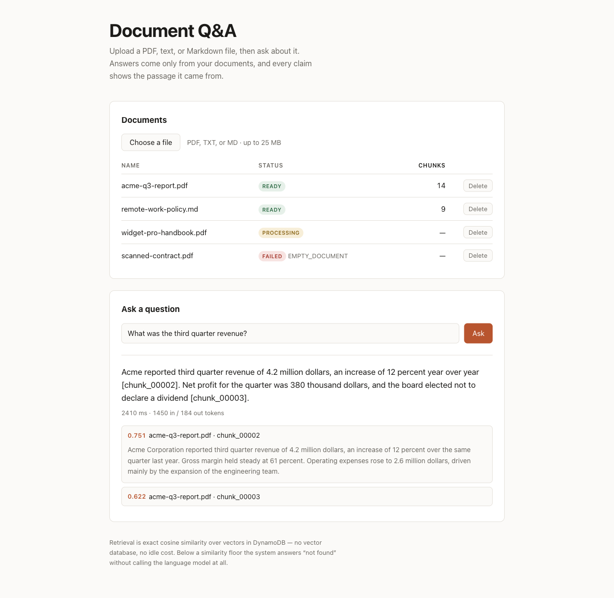

# Serverless RAG — Document Q&A

Upload a document, ask questions about it, get answers **grounded in your own text with citations to the exact passages used**. When your documents don't contain the answer, it says so instead of inventing one.

Built entirely on AWS with CDK v2 (Python). Retrieval-augmented generation implemented from first principles — no LangChain, no vector database, no always-on compute.

**Idle cost: ~$0/month.** Nothing runs until a request arrives.



<sub>More in [`screenshots/`](screenshots/) — [mobile](screenshots/mobile.png), [dark mode](screenshots/dark-mode.png), and [an out-of-scope question refused without a model call](screenshots/similarity-floor.png).</sub>

---

## What it does

```
UPLOAD                                    ASK
  browser                                   browser
    │ POST /documents                         │ POST /query
    ▼                                         ▼
  presign ──▶ S3 (direct upload, 25 MB)     embed the question
    │                                         │
    │ EventBridge: Object Created             ▼
    ▼                                       cosine similarity over every
  ingest Lambda                             stored vector, take top-k
    ├─ extract text (pypdf / utf-8)           │
    ├─ chunk (~500 tokens, 50 overlap)        ├─ best score < floor?
    ├─ embed each chunk (Titan V2)            │    └─▶ "not found", no LLM call
    └─ write chunks + vectors ──▶ DynamoDB    │
                                              └─▶ Claude, context + question
       failure ──▶ status=FAILED + DLQ              └─▶ answer + citations
```

One CloudFront distribution serves the static app and proxies `/v1/*` to API Gateway, so the browser makes same-origin calls and never holds an API key.

## Why it's built this way

Three decisions do most of the work. The full set is in [docs/ARCHITECTURE.md](docs/ARCHITECTURE.md) §4.

### Vectors live in DynamoDB, and similarity is computed in the Lambda (ADR-001)

The obvious choice is a vector database. OpenSearch Serverless has a minimum capacity floor of roughly **$300/month whether or not anyone uses it** — for a portfolio project that idles most of the time, the cost is the entire architecture.

So vectors are stored as packed `float32` in DynamoDB (about a quarter the size of a number list) and the query Lambda scores the whole corpus with one NumPy matrix multiply. It's exact rather than approximate, and it's O(n).

That trade holds to roughly **50k chunks**. Past that the DynamoDB scan — not the vector maths — becomes the bottleneck, and the migration path is pgvector on Aurora Serverless v2 or OpenSearch. [`src/shared/vector_search.py`](src/shared/vector_search.py) is deliberately the only place that would have to change.

### A similarity floor guards generation (ADR-003)

If the best retrieved chunk scores below `minSimilarity`, the system returns "not found" **without calling the language model at all**. Retrieval below the floor is noise, and answering from noise is how RAG systems hallucinate. It also means an off-topic question costs nothing to answer.

The floor is **measured, not guessed**. The value started at 0.35, picked before any embeddings existed to look at. The golden-set harness measured the actual distribution and found 0.35 was wrong in the direction nobody checks for: it rejected 5 of 12 questions the corpus demonstrably answers, including ones whose correct passage ranked *first*. Answerable questions score 0.183–0.751; out-of-scope questions never exceed 0.080. The floor now sits at 0.12, in the gap, and [a test](tests/eval/test_golden_set.py) fails if it drifts out of it.

That value is specific to the embedding model. Change `embeddingModelId` and it has to be re-measured — `python tests/eval/record.py` does that.

### The API key never reaches the browser (ADR-008)

A static site that calls an authenticated API has to keep the credential somewhere. Publishing it in the page is the common shortcut. Instead, CloudFront injects `x-api-key` as an origin header, and the value is generated at deploy time into Secrets Manager — so it exists in neither the repository nor the client. Same-origin routing also removes CORS from the design entirely.

## Quick start

**Prerequisites:** an AWS account, Python 3.12, Node 18+ (for the CDK CLI), and AWS credentials configured.

### 1. Enable Bedrock model access

This is the one step that cannot be automated, and the most common reason a first deploy fails. In the **Amazon Bedrock console → Model access** (in `us-east-1`), enable:

- `Titan Text Embeddings V2`
- `Claude Haiku 4.5`

Access being "available" in the model list does not mean it is granted to your account.

### 2. Deploy

```bash
git clone <this-repo> && cd serverless-rag
make install
make deploy
```

That's it. `make deploy` runs a preflight first — credentials, CDK bootstrap (doing it if needed), and an actual `InvokeModel` call against both Bedrock models — then deploys all five stacks and prints the URL:

```
  Open  https://d1234abcd.cloudfront.net
```

Open it, upload a PDF, and ask a question. There is nothing else to configure — no API key to paste, no environment file, no CORS origin to fill in after the fact.

Roughly 10 minutes, most of it CloudFront. To check without changing anything:

```bash
make preflight     # or: ./scripts/deploy.sh --check
```

Iterating on the UI does not need any of that. `frontend/` is three static files, so pushing a change is a sync and an invalidation rather than a CloudFormation round trip:

```bash
make deploy-frontend        # seconds
./scripts/deploy-frontend.sh --dry-run   # show what would change
```

The stack stays the source of truth — the next `make deploy` re-uploads from the committed asset and overwrites anything pushed this way, so keep `frontend/` in git.

### 3. Verify (optional)

```bash
make smoke
```

The full journey against the live stack, discovering everything from CloudFormation outputs: presign, upload a fixture PDF, poll to `READY`, ask an answerable question, ask an unanswerable one, delete.

### 4. Tear down

```bash
make destroy
```

It asks for the account number, deletes all five stacks, and then does the two things `cdk destroy` alone does not — neither of which reports an error when skipped:

- **Force-deletes the Secrets Manager secret.** CloudFormation only *schedules* secret deletion, keeping it for a recovery window of up to 30 days — and billing for it the whole time.
- **Deletes orphaned log groups.** The custom-resource Lambdas CDK generates for bucket auto-delete and asset deployment create their log groups at runtime, so no template owns them and nothing cleans them up.

Then it asks the tagging API whether anything still carries `Project=serverless-rag` and reports what it finds. Every resource is tagged, so the sweep can see all of it, and [a test](tests/infra/test_teardown.py) fails the build if a resource is ever added that would survive teardown or escape the tag.

```bash
./scripts/destroy.sh --dry-run   # show what would go, change nothing
```

**This is a demo project, not a system of record** — teardown really does delete your documents. The one thing deliberately left alone is the `CDKToolkit` bootstrap stack, which is shared with every other CDK app in the account; the script tells you how to remove it if this was the only one.

## Configuration

Everything tunable lives in `cdk.json` context — no code changes, no rebuild.

| Key | Default | What it controls |
|---|---|---|
| `region` | `us-east-1` | Deployment region (broadest Bedrock availability) |
| `embeddingModelId` | `amazon.titan-embed-text-v2:0` | Model used for both ingestion and queries |
| `generationModelId` | `us.anthropic.claude-haiku-4-5-…` | Answer generation |
| `minSimilarity` | `0.12` | The floor below which no answer is generated. Measured, not guessed — see ADR-003 |
| `maxTokens` | `1024` | Generation output cap |
| `maxUploadMb` | `25` | Upload ceiling, signed into the S3 policy |
| `chunkTargetTokens` / `chunkOverlapTokens` | `500` / `50` | Chunking |
| `alertEmail` | *(empty)* | Subscribes to alarms and the budget. Set it to get notified |

> **Model IDs:** in `us-east-1`, current Claude models are reachable **only through an inference profile** (`us.anthropic.*`). A bare `anthropic.claude-*` id fails at runtime with *"on-demand throughput isn't supported"*. Verify with `aws bedrock list-inference-profiles` before changing one.

## Cost

Idle cost is genuinely zero: no NAT gateway, no VPC, no provisioned concurrency, no vector database. A cost-guardrail test fails the build if any of those appear in a synthesized template.

| Service | Idle | Light demo use (~100 queries, 20 documents) |
|---|---|---|
| Lambda | $0 | < $0.05 |
| DynamoDB (on-demand) | $0 | < $0.05 |
| S3 | $0 | < $0.05 |
| API Gateway | $0 | < $0.01 |
| CloudFront | $0 | < $0.05 (free tier covers this) |
| Bedrock — embeddings | $0 | ~$0.02 |
| Bedrock — generation | $0 | ~$0.30 |
| **Total** | **~$0** | **well under $1** |

A **$5 monthly AWS Budget** is deployed as part of the stack. Storage is the only charge that accrues while idle, and it's fractions of a cent for a demo corpus.

## Repository layout

```
Makefile                  install · check · deploy · smoke · destroy
app.py                    CDK entry point; wires the five stacks
cdk.json                  Model IDs, region, thresholds — all configuration
scripts/
  deploy.sh                 preflight (creds, bootstrap, Bedrock) then deploy
  deploy-frontend.sh        static files only: S3 sync + CloudFront invalidation
  destroy.sh                destroy, sweep what CFN leaves, verify by tag
infra/                    One stack per concern
  storage_stack.py          S3 bucket, DynamoDB table, DLQ
  ingest_stack.py           Ingest Lambda, EventBridge rule, shared layer
  api_stack.py              REST API, four Lambdas, usage plan
  frontend_stack.py         S3 + CloudFront (OAC), API behavior
  observability_stack.py    Dashboard, alarms, budget
  bedrock_policy.py         Least-privilege InvokeModel, in one place
src/
  ingest/handler.py       S3 event → extract → chunk → embed → store
  query/handler.py        Embed → retrieve → floor → generate → cite
  documents/handler.py    Presign, list, delete
  shared/                 Lambda layer: the logic worth unit-testing
frontend/                 Vanilla JS, no build step
tests/                    unit · infra (CDK assertions) · eval · integration
docs/                     PRD, architecture and ADRs, API spec, test strategy
screenshots/              Demo captures, with a note on how they were made
```

## Development

```bash
make check      # lint, tests, and cdk synth — exactly what CI runs
```

which is:

```bash
ruff check . && ruff format --check .
pytest tests/unit tests/infra tests/eval -q --cov=src/shared --cov-fail-under=80
cdk synth --quiet
```

CI runs exactly these three, with no AWS credentials, on every pull request. Coverage on `src/shared/` sits at ~99%.

The test suite is split four ways:

| Layer | What it proves | AWS |
|---|---|---|
| `tests/unit/` | The logic is correct — moto for DynamoDB, hand-written stubs for Bedrock | none |
| `tests/infra/` | The synthesized CloudFormation says what it should | none |
| `tests/eval/` | Retrieval still finds the right passage, against **real recorded embeddings** | none |
| `tests/integration/` | The deployed system actually works end to end | real, excluded from the PR gate |

The eval layer exists because everything above it can stay green while answer quality quietly degrades. It replays embeddings produced once by the real Bedrock model and committed as a fixture, so the scores — and therefore the floor — mean something, while the gate stays offline and deterministic. It detects its own staleness: change the chunker, the corpus, or the model, and it fails with a pointer to `tests/eval/record.py` rather than silently scoring passages the system would never produce.

Runtime dependencies are `boto3`, `numpy`, and `pypdf`. That is the whole list, and it is deliberate — see ADR-004.

## Things worth knowing

- **Chunk ids are unique per document, not globally.** A citation marker matching two documents resolves to both; each citation carries its own `doc_id`.
- **Presigning creates the document record.** Abandoning an upload leaves a row in `UPLOADED`; the UI cleans up after a failed upload, and you can delete it manually.
- **`allowedOrigin` defaults to `*`** for direct calls to the execute-api URL. CORS is not a security boundary here — the API key is, and CORS cannot supply one. The deployed UI is same-origin and never relies on it.
- **The layer builds without Docker** (ADR-007), using `pip --platform manylinux2014_x86_64`, with automatic Docker fallback.

## Further reading

| Document | Contents |
|---|---|
| [docs/PRD.md](docs/PRD.md) | Requirements, goals, non-goals |
| [docs/ARCHITECTURE.md](docs/ARCHITECTURE.md) | Design, data model, and all eight ADRs |
| [docs/API_SPEC.md](docs/API_SPEC.md) | Complete HTTP contract |
| [docs/TESTING.md](docs/TESTING.md) | Test strategy per layer |
| [docs/IMPLEMENTATION_PLAN.md](docs/IMPLEMENTATION_PLAN.md) | Phased build order with acceptance criteria |
